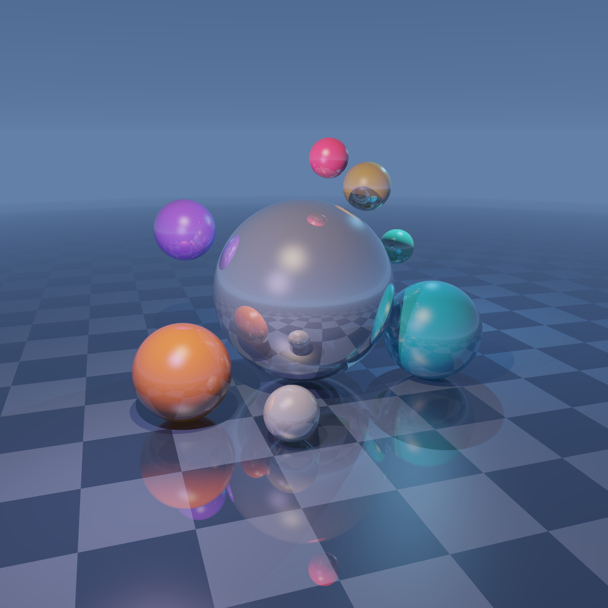
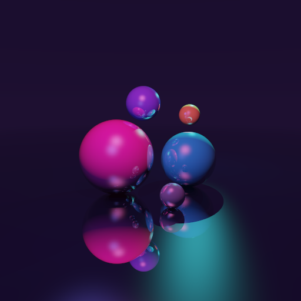
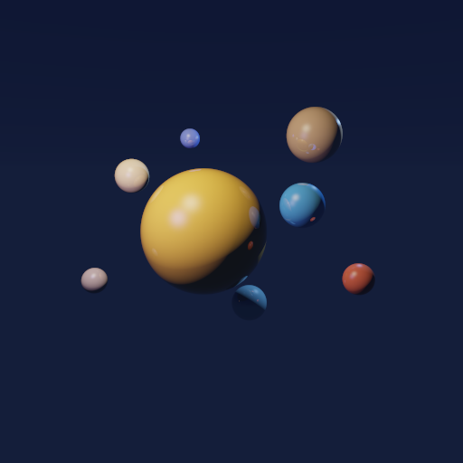
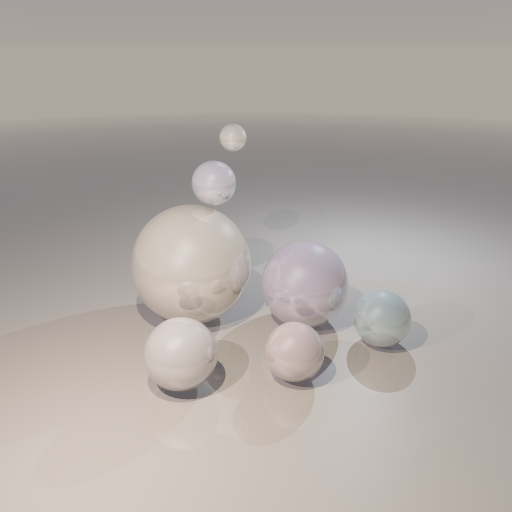

# Raytracer

Учебный рейтрейсер на **Rust**, который работает в терминале, браузере и Telegram Mini App.
В браузере сцена рендерится прямо на устройстве через **WebAssembly** — сервер раздаёт только статические файлы.

**[Открыть в Telegram → @rtracer_bot](https://t.me/rtracer_bot?startapp)** · **[Открыть в браузере](https://raytracer.rtel-lab.xyz/)**



*«Хромовая орбита» — 1024 × 1024, 16 лучей на пиксель. Все изображения ниже тоже созданы этим рейтрейсером.*

## Что можно попробовать

- **16 готовых сцен:** от зеркальных шаров и неоновой студии до планетария и снеговика.
- **Редактор сцены:** добавляй сферы, меняй их цвет, размер, положение и отражение; настраивай камеру, свет и экспозицию.
- **Качество рендера:** 128–1024 пикселя на сторону и 1, 4 или 16 лучей на пиксель. По умолчанию — 1024 × 1024 и 16 лучей.
- **Живое превью:** картинка постепенно уточняется, рендер можно отменить. Нажатие на изображение раскрывает его и сохраняет обновление во время рендера.
- **Ручной TOML:** конфигурацию можно редактировать напрямую, если возможностей ползунков недостаточно.

<table>
  <tr>
    <td align="center" width="33%">
      <br>
      <strong>Неоновая ночь</strong>
    </td>
    <td align="center" width="33%">
      <br>
      <strong>Планетарий</strong>
    </td>
    <td align="center" width="33%">
      <br>
      <strong>Жемчужная россыпь</strong>
    </td>
  </tr>
</table>

*Галерея: 512 × 512, 16 лучей на пиксель.*

## Как пользоваться

1. Открой [бота](https://t.me/rtracer_bot?startapp) или [веб-версию](https://raytracer.rtel-lab.xyz/).
2. Выбери готовую сцену. Изменения в редакторе автоматически строят быстрое превью — до 128 × 128 с одним лучом на пиксель.
3. Выбери итоговое разрешение и сглаживание, затем нажми **«Перерисовать»**.
4. Нажми на картинку, чтобы рассмотреть результат в раскрытом просмотре.

Сцена хранится только до перезагрузки страницы. В ручном режиме TOML ползунки отключены;
возврат к визуальному редактору заменяет ручные правки его настройками.

## Как это устроено

**Редактор → Web Worker → Rust / WebAssembly → Canvas.**

Общая Rust-библиотека рассчитывает пересечения лучей со сферами, тени, отражения и освещение.
Цвета накапливаются в линейном пространстве; после сглаживания применяются экспозиция, тональная компрессия и гамма-коррекция.
Фоновый свет приближённо подсвечивает сцену: это рекурсивный рейтрейсер, без расчёта глобального освещения методом path tracing.

Тяжёлые вычисления идут в Web Worker. Результат передаётся небольшими полосами, поэтому интерфейс остаётся доступным,
а прогресс виден даже на финальном проходе. Скорость зависит от устройства, сцены, разрешения и числа лучей.

Telegram SDK отвечает за тему, основную кнопку и доступную в клиенте тактильную обратную связь.
**Токен бота для работы приложения не нужен.**

## Быстрый запуск через Docker

Понадобится Docker. Выполни из корня репозитория:

```sh
docker build -t raytracer .
docker run --rm --read-only --tmpfs /tmp:rw,noexec,nosuid,size=16m \
  --cap-drop ALL --security-opt no-new-privileges:true \
  -p 127.0.0.1:8000:8080 raytracer
```

Открой [localhost:8000](http://127.0.0.1:8000/).
Образ сам собирает WASM из исходников. В финальном слое — статические файлы и nginx,
работающий без root на порту `8080`. Проверка состояния: `/healthz`.

Про размещение за Traefik см. [инструкцию деплоя](deploy/README.md),
про подключение своего бота — [настройку Telegram Mini App](docs/telegram.md).

## Локальная сборка без Docker

Нужны Rust **1.99+**, `rustup` и Python 3 для локального HTTP-сервера.

```sh
rustup target add wasm32-unknown-unknown
cargo install wasm-bindgen-cli --version 0.2.130 --locked
cargo build --locked --release --lib --target wasm32-unknown-unknown
wasm-bindgen --target web --out-dir web/pkg target/wasm32-unknown-unknown/release/raytracer.wasm
python3 -m http.server 8000 --bind 127.0.0.1 --directory web
```

Открой [localhost:8000](http://127.0.0.1:8000/).
Версия `wasm-bindgen-cli` должна совпадать с `wasm-bindgen` в `Cargo.lock`.
Сгенерированная папка `web/pkg/` не хранится в Git.

### Рендер из терминала

```sh
cargo run --locked --release -- config/reflect.toml
```

CLI сохраняет изображение в бинарном формате PPM с именем из конфигурации.
Пример настроек камеры, света и материалов — [config/reflect.toml](config/reflect.toml).

## Структура проекта

| Путь | Назначение |
| --- | --- |
| `src/` | Общий Rust-рендерер, конфигурация и вывод изображения |
| `src/browser.rs` | WASM API для JavaScript |
| `web/` | Интерфейс, редактор, Web Worker и прогрессивная отрисовка |
| `web/scene-presets.js` | Готовые сцены |
| `tests/` | JS-тесты; в `tests/browser/` — Playwright и тестовый Telegram-интерфейс |
| `scripts/` | Проверки реального WASM и HTTP |
| `docker/`, `deploy/` | nginx и развёртывание через Compose / Traefik |

## Проверки

Для JS-тестов нужен **Node.js 22+**. Rust и JS проверяются отдельно:

```sh
cargo fmt --check
cargo clippy --locked --all-targets -- -D warnings
cargo test --locked
npm ci
npm test
npm run format:check
node scripts/check-wasm.mjs # после сборки WASM и генерации web/pkg/
```

Для браузерных проверок сначала запусти приложение локально или в контейнере:

```sh
npx playwright install chromium
npm run test:browser
```

Проверяются все пресеты, редактор, сглаживание, отмена, рендер 1024 × 1024 и обновление раскрытого изображения.
Отдельные сценарии моделируют интерфейс Telegram и отказ нативной кнопки; они не заменяют проверку на реальном телефоне.

- `npm run test:layout` — запустить только Telegram-сценарии.
- `PREVIEW_URL` — адрес проверяемого приложения; по умолчанию `http://127.0.0.1:8000`.
- `CHROME_PATH` — путь к установленному Chrome вместо скачанного Chromium.
- `node scripts/check-http.mjs` — проверить HTTP, заголовки и загрузку WASM из контейнера.
- `npx playwright show-report review-output/report` — открыть HTML-отчёт. Скриншоты и трассировки ошибок находятся в `review-output/`.

CI проверяет Rust, WASM и JS, собирает Docker-образ и запускает браузерные тесты на нём.
Деплой автоматически не выполняется.
